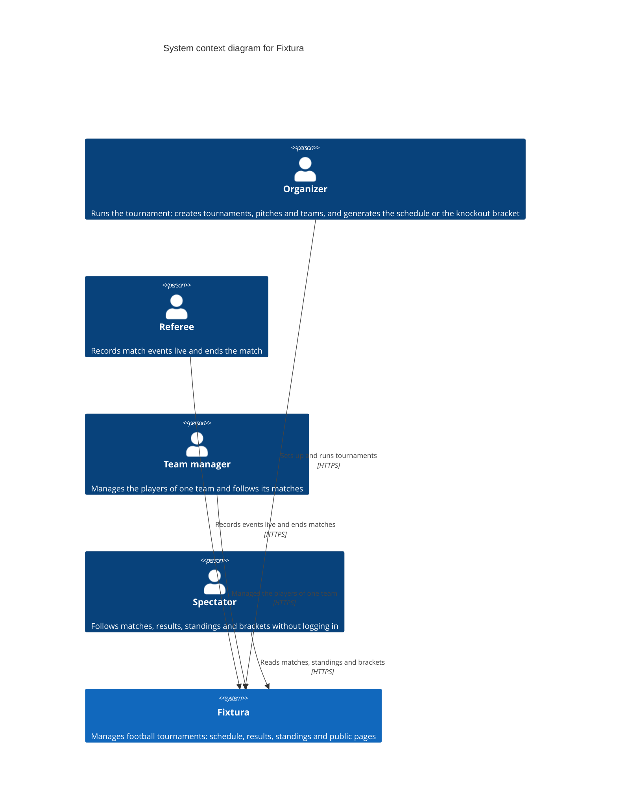

# C4 level 1: system context

Author: the Fixtura developer
Last updated: 25 November 2026

## 1. Purpose of this document

The C4 model describes a software system with four diagrams, each one zooming in further on the previous one:

1. **Context**: the system as one box, with the people and other systems around it.
2. **Containers**: the programs and data stores the system is made of (a website, a server application, a database).
3. **Components**: the parts inside one container.
4. **Code**: the classes inside one component.

This document is level 1. It shows what Fixtura is and who uses it, and it does not show how Fixtura is built inside. The inside is described in the container diagrams, which are separate documents.

## 2. Diagram

## 3. Elements

### 3.1 People

| Element | Has an account | What the person does |
|---|---|---|
| Organizer | Yes | Creates and edits tournaments and pitches, adds teams, players, referees and team managers, generates the league schedule or the knockout bracket, and sees only their own tournaments. The organizer does not take part in the results. |
| Referee | Yes | Records the events of the matches assigned to them (goals, cards, substitutions) live and ends the match, which makes the result final. |
| Team manager | Yes | Manages the players of their own team and follows its matches and results. A team manager cannot see or change any other team. |
| Spectator | No | Reads public matches, results, standings and brackets. A spectator is anonymous and cannot change anything. |

### 3.2 The system

**Fixtura** is the only software system in this diagram. It stores the tournaments, pitches, teams, players, matches, events and standings. It enforces the rules that keep the data correct: no two overlapping matches on the same pitch, referee or team, a score calculated from the goal events, and a league table calculated from finished matches. It also checks who is allowed to do what, and it keeps a log of important changes.

## 4. Relationships

Every person reaches Fixtura through a web browser, over HTTPS. HTTPS is the secure form of the protocol that browsers use to talk to websites.

| From | To | Purpose |
|---|---|---|
| Organizer | Fixtura | Sets up and runs tournaments |
| Referee | Fixtura | Records events live and ends matches |
| Team manager | Fixtura | Manages the players of one team |
| Spectator | Fixtura | Reads matches, standings and brackets |

The arrows point from the person to the system because the person starts every interaction. Fixtura never contacts people on its own in the first version.

## 5. What is outside the system

Fixtura has no connection to any other software system in its first version. I decided on this boundary on purpose:

- Fixtura does not send emails. An organizer gives temporary passwords to referees and team managers directly.
- Fixtura does not process payments, for example registration fees.
- Fixtura does not import data from other tournament systems or publish data to other websites.

Because there is no external system, the diagram has none. If one is added later, for example an email service, it appears in this diagram as an external system with its own relationship.

## 6. The two architectures

This diagram is the same for both architectures of Fixtura. The monolith and the distributed version have the same users and the same boundary, because they solve the same problem. They differ only inside the box. The container diagrams show that difference: one server application and one database in the monolith, and a message broker and a separate worker program added in the distributed version.

## 7. Related documents

- `docs/architecture/01-architecture-characteristics.md`: the requirements and the ranked characteristics.
- `docs/decisions/001-monolith-first-then-distributed.md`: why there are two architectures.
