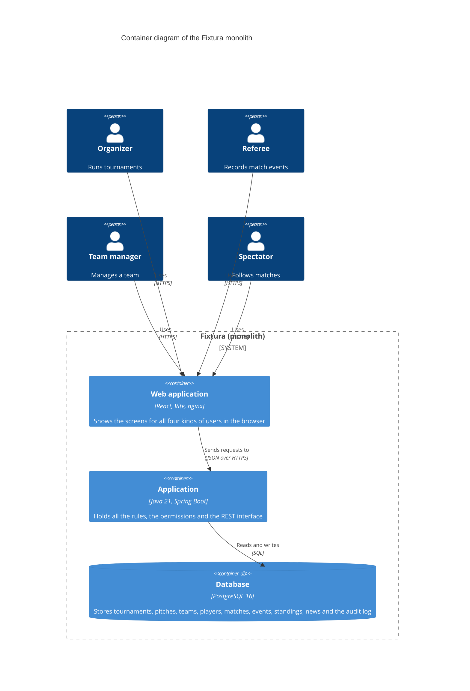
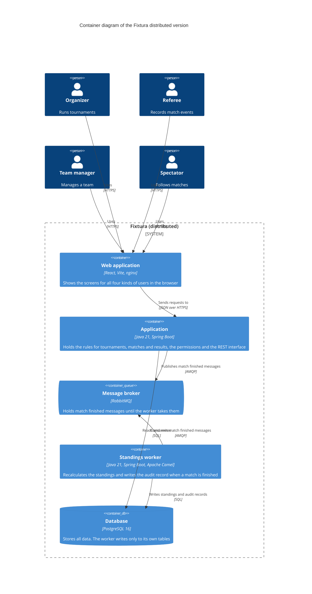

# C4 level 2: containers

Author: Abel Zewdie Menkir

Last updated: 25 November 2026

## 1. Purpose of this document

Level 1 of the C4 model (`02-c4-context.md`) shows Fixtura as one box. This document opens the box. It shows the containers Fixtura is made of.

In C4, a container is not a Docker container, although in Fixtura every container also runs as one. A container is anything that runs on its own and that has to be running for the system to work: a website, a server application, a database, a message broker. Each container is a separate thing that can be started, stopped and replaced.

Fixtura has two architectures that solve the same problem (see `docs/decisions/001-monolith-first-then-distributed.md`), so this document has two diagrams: one for the monolith and one for the distributed version.

## 2. Architecture 1: the monolith

### 2.1 Containers

| Container | Technology | Responsibility |
|---|---|---|
| Web application | React, Vite, served by nginx | Everything the person sees: the public pages for spectators and the screens for organizers, referees and team managers. It contains no business rules. It shows data and sends the person's actions to the application. |
| Application | Java 21, Spring Boot | The whole server side in one program. It checks who is logged in, enforces every rule (conflicts, score from events, standings, ownership), writes the audit log and offers a REST interface. REST is a style of web interface where each thing (a tournament, a match) has its own address and is read or changed with standard requests. |
| Database | PostgreSQL 16 | The only place where data is stored. Related changes are saved in one transaction, which means that all of them are saved or none is. |

### 2.2 Relationships

| From | To | Purpose |
|---|---|---|
| People | Web application | Use the screens in a browser |
| Web application | Application | Ask for data and send actions, as JSON over HTTPS. JSON is a simple text format for data. |
| Application | Database | Read and write all data with SQL |

### 2.3 Why this is a monolith

The application is one program. When a referee confirms a result, the application saves the result, recalculates the standings and writes the audit entry inside one database transaction. Either all three happen or none does. This is the reason the monolith protects my first characteristic, data consistency, in the simplest possible way.

Inside the application the code is divided into modules: identity and access, pitches, teams and players, tournaments and draw, matches and results, standings, news and audit. They are not separate containers. A module is a group of code in the same program, and it talks to the other modules only through small public interfaces.

## 3. Architecture 2: the distributed version

### 3.1 What is new compared with the monolith

| Container | Technology | Responsibility |
|---|---|---|
| Message broker | RabbitMQ | A post office between programs. One program leaves a message, and another program picks it up when it is ready. A message waits in the broker until it is taken, so it is not lost if the receiver is stopped. |
| Standings worker | Java 21, Spring Boot, Apache Camel | A separate program with no web interface. It receives a message for every finished match, recalculates the standings and writes the audit record. Apache Camel is the library that defines the route a message follows: from the queue, to the calculation, to the database. |

The web application and the database are the same as in the monolith. The application is smaller: it no longer calculates the standings itself, and it publishes a message instead. The public pages still read the standings through the application.

### 3.2 What happens when a match is finished

1. The referee confirms the final result in the web application.
2. The application checks the permissions and the rules, and saves the result in the database.
3. The application publishes a "match finished" message to the broker. AMQP is the protocol that RabbitMQ uses.
4. The worker takes the message from the broker, recalculates the standings and writes the audit record.
5. From then on the public pages show the new table.

### 3.3 What this changes

- **Consistency.** The result is saved before the message is sent, so a confirmed result is never lost. The standings are updated a moment later. For a short time the result exists and the table does not include it yet.
- **Failure of the worker.** If the worker is stopped, the application keeps working and the messages wait in the broker. When the worker starts again, it processes them and the table catches up.
- **Repeated messages.** A message can be delivered twice. The calculation of the standings is written so that running it twice gives the same table.
- **More to run.** Five containers start instead of three.

## 4. How the two architectures compare

| Point | Monolith | Distributed version |
|---|---|---|
| Containers | 3: web application, application, database | 5: web application, application, message broker, standings worker, database |
| Where the standings are calculated | Inside the application, in the same transaction as the result | In the worker, after the result is saved |
| Table after a result | Correct immediately | Correct a moment later |
| If the standings calculation fails | The whole transaction is undone, and the result is not saved | The result stays saved and the message is processed again |
| Starting the system | Three containers | Five containers |

## 5. Deployment

Every container runs as a Docker container and the whole system starts with Docker Compose, which is a tool that starts several containers together from one file. The application listens on port 8081, because port 8080 is already used by another program on my computer. The database is available on port 5434 of my computer.

## 6. Related documents

- `docs/architecture/01-architecture-characteristics.md`: the ranked characteristics.
- `docs/architecture/02-c4-context.md`: the system and its users.
- `docs/decisions/001-monolith-first-then-distributed.md`: why, there are two architectures.
