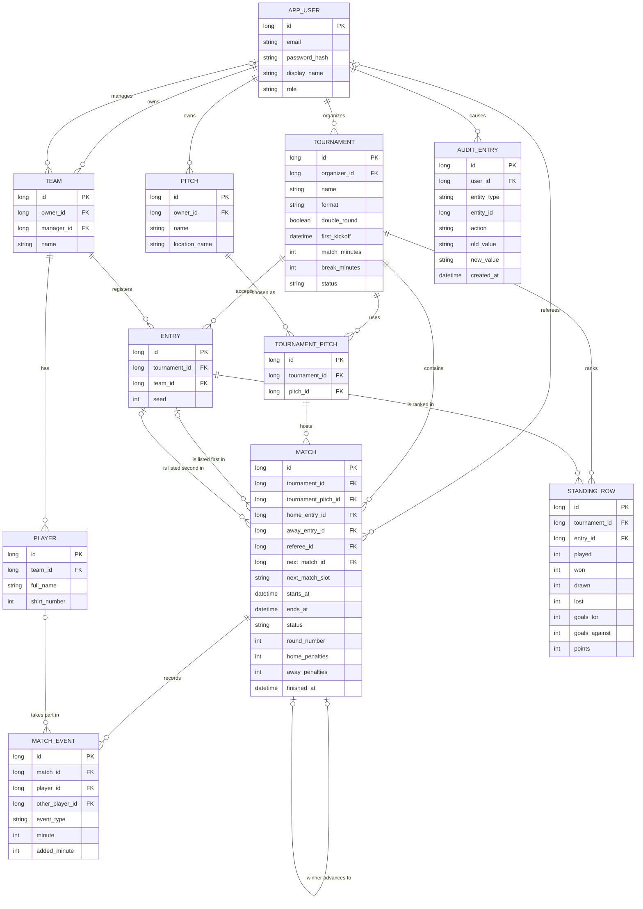
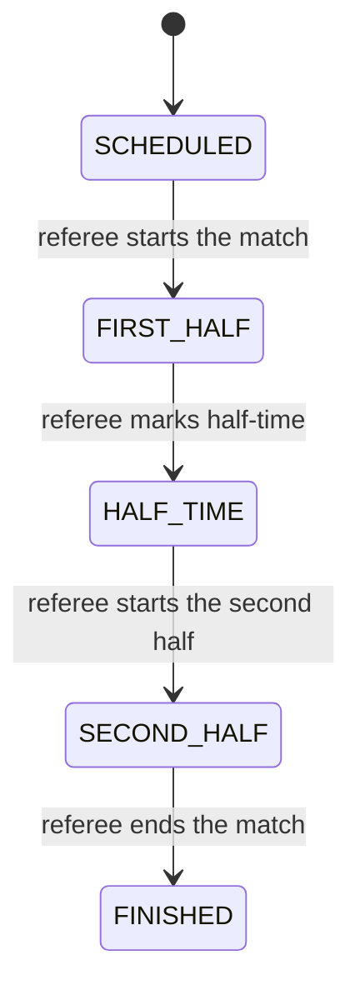

# Domain model

Author: Abel Zewdie Menkir

Last updated: 27 November 2026

## 1. Purpose of this document

The domain model describes the things Fixtura keeps track of, how they are connected, and the rules that always hold between them. It is the map of the data. I write it before the features, so that the database tables and the Java classes follow one clear design.

Fixtura is built for a local tournament organizer. The organizer runs a tournament in one of two formats, a **league** in which everyone plays everyone, or a **knockout** in which the winner of each match advances. The model is kept small on purpose. The mechanisms of a professional competition, such as match sheets and suspensions, are described in section 9 as planned extensions.

A few words I use:

- An **entity** is a kind of thing the system stores, for example a team or a match. Each entity becomes a table in the database and a class in the code.
- An **attribute** is one piece of information about an entity, for example the name of a team.
- A **relationship** connects two entities, for example "a team has many players".
- A **derived value** is calculated from other data and is never typed in by hand, for example the score of a match.

## 2. Diagram

The diagram calls the user entity `APP_USER` because `USER` is a reserved word in many databases.

## 3. Where the matches are played

In Fixtura, teams do not have a home ground. A tournament takes place on pitches that the organizer decides on.

- The organizer adds **pitches** to a catalogue. A pitch has a name, such as "Pitch 2", and the name of the place it is in.
- For every tournament, the organizer chooses which pitches are used. This is the `TOURNAMENT_PITCH` entity. A pitch that was not chosen for a tournament cannot host its matches.
- The schedule starts at the first kick-off of the tournament. Each match lasts the match length plus the break, and the matches are placed one after another on the chosen pitches.
- Because no team plays at home, "home" and "away" only mean the order in which the two teams are listed. They do not describe a location.

## 4. The two formats

### 4.1 League

Every team plays every other team once. If the tournament is set to a double round, every team plays every other team twice. The schedule is generated with the circle method, which arranges the teams in rounds so that no team plays twice in a round. If the number of teams is odd, one team rests in each round.

The table is calculated from the finished matches.

### 4.2 Knockout

The teams are placed in a bracket of single elimination. If the number of teams is not a power of two (2, 4, 8, 16 and so on), the bracket is filled up with **byes**. A bye is a free pass: the team goes straight to the next round. The teams with the best seed receive the byes.

Every match knows which match comes next (`next_match_id`) and whether the winner takes the first or the second place in it (`next_match_slot`). When a match is finished, the winner is placed into the next match automatically. The winner of the final is the champion, and the tournament becomes FINISHED.

A knockout match cannot end in a draw. If the goals are level at full time, the referee records the result of a penalty shoot-out, and the team with more penalties wins.

## 5. Entities

| Entity | What it is | Main rules |
|---|---|---|
| **App user** | A person with an account: an organizer, a referee or a team manager. A spectator has no account and no entry here. | The email is unique. The password is stored only as a hash. The role is one of ORGANIZER, REFEREE and TEAM_MANAGER. |
| **Pitch** | A playing field, with a name and the name of the place it is in. | Belongs to one organizer. The name is unique for that organizer. |
| **Team** | A football team. It has no home ground. | Belongs to one organizer and can be managed by one team manager. |
| **Player** | A person who plays for a team, with a shirt number. | Belongs to one team. The shirt number is unique inside the team. |
| **Tournament** | A competition run by one organizer, with a format (LEAGUE or KNOCKOUT), the time of the first kick-off, the length of a match, the break between matches, and a status (DRAFT, RUNNING or FINISHED). | Visible and editable only for its organizer. The format and the teams can only change while it is in DRAFT. |
| **Tournament pitch** | A pitch that the organizer chose for a tournament. | A match can only use a tournament pitch. |
| **Entry** | The registration of a team in a tournament, with a seed that decides the byes in a knockout. | A team appears at most once in a tournament, and in only one unfinished tournament at a time. |
| **Match** | A game between two entries on one tournament pitch, with a start time, an end time, a referee and a status (SCHEDULED, FIRST_HALF, HALF_TIME, SECOND_HALF or FINISHED). In a knockout it also knows the next match, and it can have penalty results. | The two entries are different. In a knockout, an entry can be empty until the winner of an earlier match is known. See the rules in section 8. |
| **Match event** | One thing that happened in a match: a goal, an own goal, a yellow card, a red card or a substitution, with the minute, the added minutes and the players involved. | Only for players of the two teams, and only while the match is in the first or second half. |
| **Standing row** | One line of the league table for one entry in one tournament. | Derived from finished matches. Never edited by hand. |
| **Audit entry** | A record of an important change: who changed which entity, the action, and the old and new values. | Entries are only added, never changed or deleted. |

## 6. A match, live

During a match, the referee records each event as it happens, and the public page shows it within seconds. This is how live scores work in professional football: the events are entered while the match is played, shown at once, and the result is final at full time.

An example of what a spectator sees for one match:

| Minute | What is shown | Score |
|---|---|---|
| 0' | Kick-off | 0 - 0 |
| 12' | Goal for the first team | 1 - 0 |
| 23' | Yellow card for a player of the second team | 1 - 0 |
| 45' | Half-time | 1 - 0 |
| 46' | Second half starts | 1 - 0 |
| 60' | Substitution for the second team | 1 - 0 |
| 78' | Goal for the second team | 1 - 1 |
| 90' | Full time | 1 - 1 |

The score column is never typed. It is calculated from the goal events.

A match moves through five statuses:

Only the referee moves the match forward. When the referee ends the match, the result is final and counts at once. Nobody has to approve it, and the organizer does not take part in the results.

## 7. Who may do what

| Role | May |
|---|---|
| **Organizer** | Create and edit their own pitches, teams, players, tournaments and entries. Choose the pitches of a tournament. Generate the schedule or the bracket. Create the accounts of referees and team managers, and assign a referee to a match. |
| **Referee** | See the matches assigned to them. Start a match, record and remove events while it is in progress, and end it. |
| **Team manager** | See and manage the players of their own team. See the matches and results of their own team. |
| **Spectator** | Read public tournaments, matches, live events, tables and brackets. Nothing else. |

## 8. Rules that always hold

**Scheduling**

1. **No conflicts.** A pitch, a referee or a team cannot be in two matches whose times overlap. Two times overlap if one starts before the other ends and ends after the other starts.
2. **Chosen pitches.** A match can only be scheduled on a pitch that the organizer chose for the tournament.
3. **One tournament at a time.** A team can be in only one unfinished tournament at a time.
4. **Schedule only from DRAFT.** The schedule or the bracket is generated once, while the tournament is in DRAFT. After that the tournament is RUNNING and its teams and format do not change.

**Players**

5. **Shirt numbers.** A shirt number is unique inside a team.
6. **Events involve the right players.** A match event can only involve players of the two teams in the match.

**During the match**

7. **Events.** Events can only be added while the match is in the first or second half. The referee can remove an event that was entered by mistake while the match is in progress, and the removal is logged.
8. **The result is live and then final.** Events are saved when the referee records them, and spectators see them at once. When the referee ends the match, the result is final. A finished match cannot be changed.
9. **The score is derived.** The score of a match is the number of goal events for each side, with an own goal counting for the opposing side. It is never stored as a number that someone can edit.

**After the match**

10. **The table is derived.** A win gives 3 points, a draw gives 1 point and a loss gives 0 points. Only finished matches count. Teams are ranked by points, then by goal difference, then by goals scored, then by name.
11. **A knockout has a winner.** A knockout match cannot be ended with a level score unless the penalty results are recorded and are different. The winner is placed into the next match.
12. **The champion.** When the final of a knockout is finished, the winner is the champion and the tournament becomes FINISHED. A league becomes FINISHED when all its matches are finished.

**Access and audit**

13. **Ownership.** An organizer sees and changes only their own pitches, teams, tournaments and matches. A team manager acts only on their own team. A referee acts only on the matches assigned to them.
14. **Audit.** Every change to a result, a fixture, a match status or a user adds an audit entry, with the user, the time, and the old and new values.

## 9. Planned extensions

The model is designed so that the following can be added later without changing what exists. These are the mechanisms of a professional competition:

- squad registration and **match sheets** that each team hands in before a deadline and that are locked afterwards
- **suspensions** after red cards and after a number of yellow cards
- a **disciplinary officer**, a separate role that is the only one who can correct a finished result, with a reason for every correction
- protests, forfeits, postponed and abandoned matches
- extra time in a knockout
- other match officials, and a separate operator who enters live events
- competition rules stored as data for each tournament, such as points and tie-breaks
- groups followed by a knockout
- head-to-head results as a tie-break

## 10. Related documents

- `docs/architecture/01-architecture-characteristics.md`: the requirements behind these rules.
- `docs/architecture/03-c4-containers.md`: where the data is stored and who changes it.
