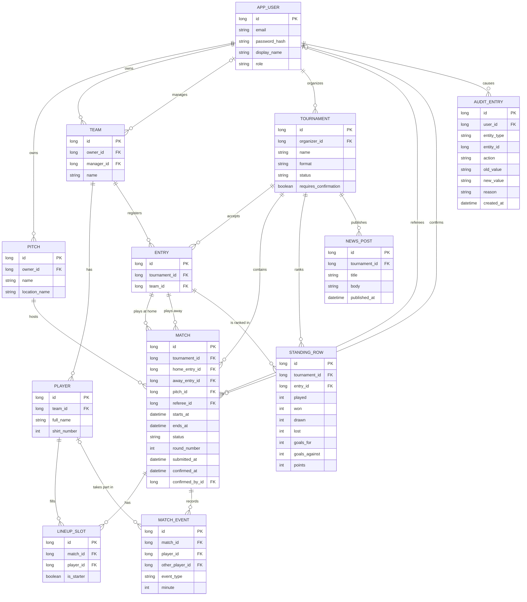
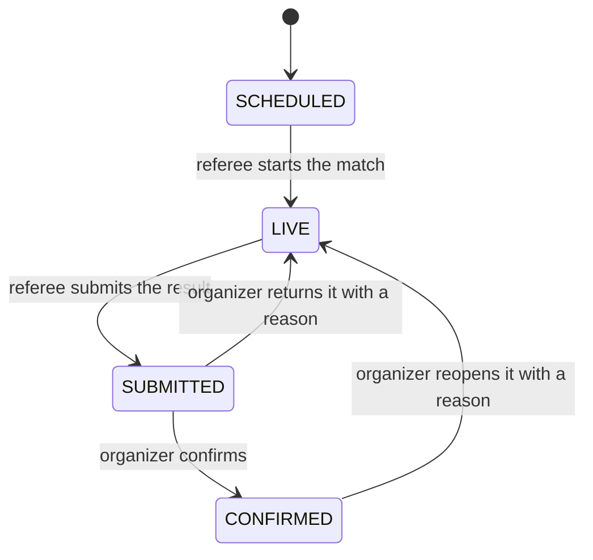

# Domain model

Author: Abel Zewdie Menkir
Last updated: 26 November 2026

## 1. Purpose of this document

The domain model describes the things Fixtura keeps track of, how they are connected, and the rules that always hold between them. It is the map of the data. I write it before the first feature, so that the database tables and the Java classes follow one clear design.

A few words I use:

- An **entity** is a kind of thing the system stores, for example a team or a match. Each entity becomes a table in the database and a class in the code.
- An **attribute** is one piece of information about an entity, for example the name of a team.
- A **relationship** connects two entities, for example "a team has many players".
- A **derived value** is calculated from other data and is never typed in by hand, for example the score of a match.

## 2. Diagram

The diagram calls the user entity `APP_USER` because `USER` is a reserved word in many databases.

## 3. Entities

| Entity | What it is | Main rules |
|---|---|---|
| **App user** | A person with an account: an organizer, a referee or a team manager. A spectator has no account and no entry here. | The email is unique. The password is stored only as a hash. The role is one of ORGANIZER, REFEREE and TEAM_MANAGER. |
| **Pitch** | A playing field where a match is scheduled, with a name such as "Pitch 2" and the name of the place it is in. | Belongs to one organizer. The name is unique for that organizer. |
| **Team** | A football team. | Belongs to one organizer and can be managed by one team manager. |
| **Player** | A person who plays for a team. | A shirt number is unique inside a team. |
| **Tournament** | A competition run by one organizer, with a format (LEAGUE or KNOCKOUT), a status (DRAFT, RUNNING or FINISHED) and a setting that says whether results must be confirmed by the organizer. | A tournament is visible and editable only for its organizer. Confirmation is switched on by default. |
| **Entry** | The registration of a team in a tournament. | A team appears at most once in a tournament, and in only one unfinished tournament at a time. |
| **Match** | A game between two entries on one pitch, with a start time, an end time, a referee and a status (SCHEDULED, LIVE, SUBMITTED or CONFIRMED). | The two entries are different. See the conflict rule in section 5. |
| **Line-up slot** | One player in the line-up of one match, as a starter or as a substitute. | The player belongs to one of the two teams in the match. A player appears once per match. |
| **Match event** | One thing that happened in a match: a goal, an own goal, a yellow card, a red card or a substitution, with the minute and the players involved. | Events can only be added while the match is live. |
| **Standing row** | One line of the league table for one entry in one tournament. | Derived from confirmed matches. Never edited by hand. |
| **News post** | A short article shown on the public pages of a tournament. | Written by the organizer of the tournament. |
| **Audit entry** | A record of an important change: who changed which entity, the action, the old and new values, and the reason when one is required. | Entries are only added, never changed or deleted. |

## 4. Match status flow

A match moves through four statuses. The referee moves it forward until the result is submitted. The organizer decides whether the result is accepted.

This is the maker and checker principle. The maker (the referee) produces the result, and a different person, the checker (the organizer), approves it before it counts. A second look catches mistakes before they reach the public table. If a tournament does not need this check, the organizer can switch it off, and a submitted result then becomes CONFIRMED at once.

## 5. Rules that always hold

1. **No conflicts.** A pitch, a referee or a team cannot be in two matches whose times overlap. Two times overlap if one starts before the other ends and ends after the other starts.
2. **The score is derived.** The score of a match is the number of goal events for each side, with an own goal counting for the opposing side. The score is never stored as a separate number that someone can edit.
3. **The table is derived.** A win gives 3 points, a draw gives 1 point and a loss gives 0 points. Only confirmed matches count. Teams are ranked by points, then by goal difference, then by goals scored, then by name.
4. **Ownership.** An organizer sees and changes only their own pitches, teams, tournaments and matches. A team manager acts only on their own team. A referee acts only on the matches assigned to them.
5. **Line-ups.** A line-up can only contain players of the two teams in the match.
6. **Results need a second person.** The referee who records a match (the maker) submits the final result, and the organizer of the tournament (the checker) confirms it. The two roles are different people. Only confirmed matches count in the table. The organizer can return a submitted result to the referee and must give a reason. If an organizer switches confirmation off for a tournament, a submitted result is confirmed at once, and the audit log still records who submitted it.
7. **Confirmed matches are frozen.** After a match is CONFIRMED, its events and line-up cannot change. If a mistake is found, the organizer reopens the match and must give a reason. The match goes back to LIVE and drops out of the table, the referee corrects it and submits it again, and the organizer confirms it again.
8. **Audit.** Every change to a result, a fixture, a match status or a user adds an audit entry. Returning or reopening a match also stores the reason.

## 6. Derived data

| Value | Calculated from |
|---|---|
| Score of a match | The goal and own goal events of the match |
| Standing rows | The confirmed matches of the tournament |
| Winner of a knockout match | The score, and the result of extra time or penalties if the score is level |

In the monolith, these values are recalculated inside the same database transaction that saves the result. In the distributed version, the standing rows are recalculated by the worker after the result is saved (see `03-c4-containers.md`).

## 7. Related documents

- `docs/architecture/01-architecture-characteristics.md`: the requirements behind these rules.
- `docs/architecture/03-c4-containers.md`: where the data is stored and who changes it.
